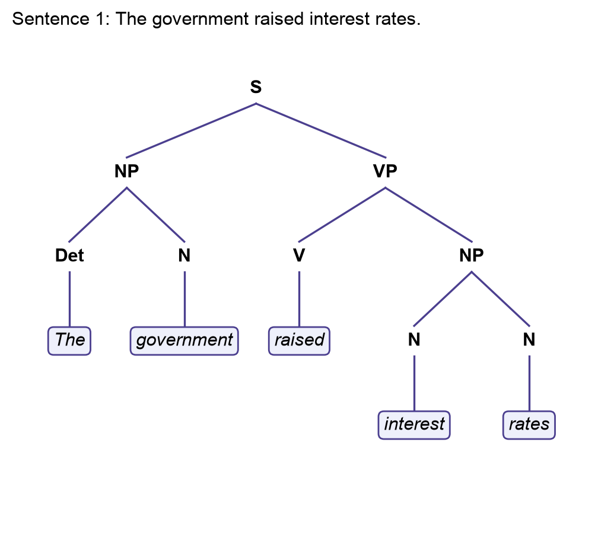
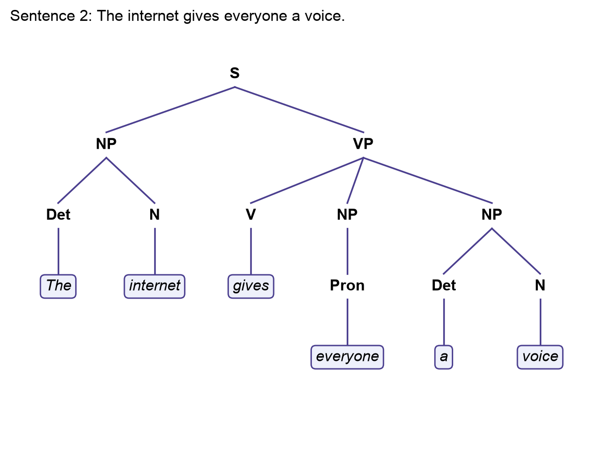
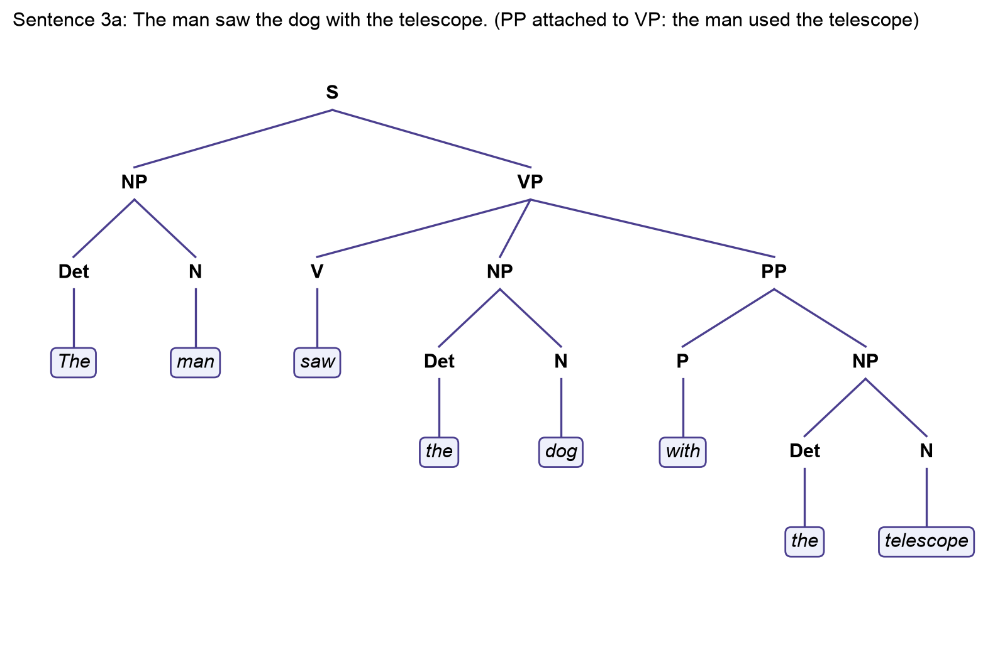
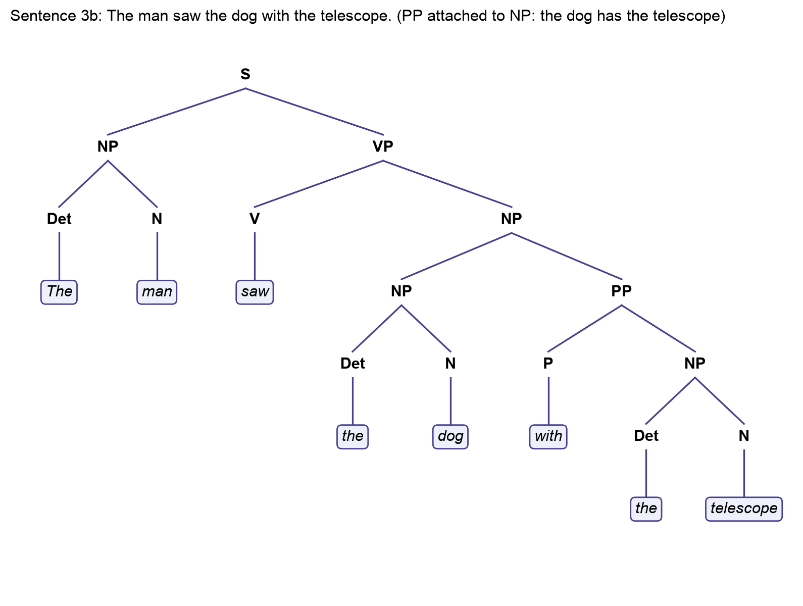

# Unit 8: Creating Parse Trees

*Create a constituency-based parse tree for each of the following phrases.*

A constituency tree groups words into nested phrases (noun phrase, verb phrase, prepositional phrase) under a sentence node, which is different from the dependency graphs produced by tools such as spaCy, where each word points to its head (Zimmerman, 2019). I drew the trees with a short script ([`code/parse_trees.py`](code/parse_trees.py)) from bracketed notation so that the structure and the picture cannot disagree.

## 1. The government raised interest rates.

`(S (NP (Det The) (N government)) (VP (V raised) (NP (N interest) (N rates))))`

"Interest rates" is a compound noun, so both words sit under the object noun phrase.

## 2. The internet gives everyone a voice.

`(S (NP (Det The) (N internet)) (VP (V gives) (NP (Pron everyone)) (NP (Det a) (N voice))))`

"Gives" is ditransitive: the verb phrase contains an indirect object ("everyone") and a direct object ("a voice") as two sister noun phrases.

## 3. The man saw the dog with the telescope.

This sentence is structurally ambiguous, and a constituency tree is exactly the tool that makes the ambiguity visible. The prepositional phrase "with the telescope" can attach to the verb phrase, meaning the man used the telescope to see the dog:

`(S (NP (Det The) (N man)) (VP (V saw) (NP (Det the) (N dog)) (PP (P with) (NP (Det the) (N telescope)))))`

Or it can attach to the object noun phrase, meaning the dog had the telescope:

`(S (NP (Det The) (N man)) (VP (V saw) (NP (NP (Det the) (N dog)) (PP (P with) (NP (Det the) (N telescope))))))`

The words and their part-of-speech tags are identical in both trees; only the attachment differs. A parser cannot resolve this from syntax alone, which is why statistical parsers choose the more probable attachment and why the chatbot I built asks a clarifying question when a request is ambiguous rather than guessing.

### Reference

Zimmerman, V. (2019) *Getting to grips with parse trees*. Towards Data Science, 12 November. Available from: https://towardsdatascience.com/getting-to-grips-with-parse-trees-6e19e7cd3c3c/ [Accessed 28 October 2026].
